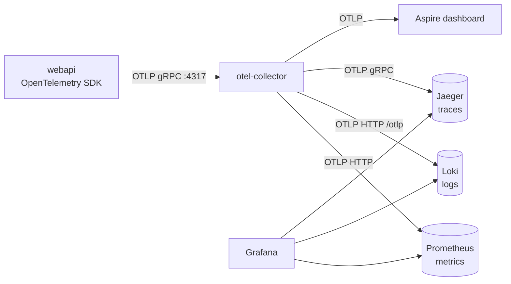

# Observability

The portal produces logs, metrics and traces with OpenTelemetry and sends all three over OTLP to **one endpoint**, `Observability:OtlpEndpoint`. Locally that endpoint is an OpenTelemetry Collector, which forwards everything to Prometheus (metrics), Loki (logs) and Jaeger (traces). Grafana shows all three, and the Aspire dashboard still gets a copy. The design is in [ADR-007](decisions/ADR-007-OpenTelemetry-Observability.md).



## Start the stack

The stack is part of the normal local run. Every container is an Aspire resource in `src/AppHost/ObservabilityStack.cs`; there is no docker-compose file (AGENTS.md section 6). Docker Desktop or Podman must be running. From `Education Portal Full Stack App`:

```bash
aspire run                                 # or: dotnet run --project src/AppHost
```

| What | Local URL | Notes |
|---|---|---|
| Grafana | http://localhost:3000 | Anonymous admin, local only. Dashboard: **Education Portal > Education Portal overview** |
| Prometheus | http://localhost:9090 | Receives OTLP at `/api/v1/otlp` |
| Jaeger UI | http://localhost:16686 | Service `webapi` |
| Loki | http://localhost:3100 | API only; browse logs in Grafana (Explore > Loki) |
| OTel Collector | `localhost:4317` (gRPC), `localhost:4318` (HTTP) | The app's only telemetry endpoint |
| Aspire dashboard | printed in the console | Still gets every log, metric and trace |

Prometheus, Loki, Jaeger and Grafana keep their data in named volumes (`educationportal-prometheus-data`, `educationportal-loki-data`, `educationportal-jaeger-data`, `educationportal-grafana-data`) and are persistent containers, so data survives an app restart. Retention is 7 days. To start empty, stop the containers and delete the volumes in Docker Desktop.

The Collector config is `src/AppHost/observability/otel-collector.yaml`. Grafana's data sources and dashboard are provisioned from `src/AppHost/observability/grafana/`; edit the JSON in the repository, not in the Grafana UI (the UI cannot save provisioned dashboards).

### Check that each signal arrives

With the app running, send a few requests, then wait about 10 seconds:

```bash
# Requests on the master tenant and the Demo School (use the webapi https port from the Aspire dashboard).
for i in $(seq 1 20); do curl -sk https://localhost:7052/api/Branding -o /dev/null; curl -sk -H "Host: demo.localhost" https://localhost:7052/api/Branding -o /dev/null; done

# Traces: webapi is listed, then the last traces with their spans.
curl -s http://localhost:16686/api/services
curl -s "http://localhost:16686/api/traces?service=webapi&limit=5"

# Metrics: request counts per route and status code.
curl -s http://localhost:9090/api/v1/query --data-urlencode 'query=sum by (http_route, http_response_status_code) (http_server_request_duration_seconds_count{job="webapi"})'

# Logs: the latest lines that carry a trace id, with tenant_id.
curl -s -G http://localhost:3100/loki/api/v1/query_range --data-urlencode 'query={service_name="webapi"} | trace_id!=""' --data-urlencode 'limit=5'
```

## Walkthrough: from a request to its trace and logs

1. Open the Angular app from the Aspire dashboard and click around, or run the `curl` loop above.
2. Open Grafana at http://localhost:3000 > **Dashboards > Education Portal > Education Portal overview**. Request rate, error rate and p95 latency are at the top; the **Top 10 slow endpoints** table shows the slowest routes.
3. **Find the trace.** Go to **Explore**, pick **Jaeger**, search service `webapi`, and open a trace such as `GET /api/Branding/`. The HTTP span carries `tenant.id`; the `postgresql` child spans are the EF Core queries.
4. **Trace to logs.** In the trace view, click the log icon on a span (**Logs for this span**). Grafana runs `{service_name=~".+"} | trace_id="<trace id>"` against Loki and shows every log line of that request.
5. **Logs to trace.** In the overview dashboard's **Recent logs** panel (or Explore > Loki with `{service_name="webapi"}`), expand a line. Its `trace_id` field has a **View trace** link that opens the trace in Jaeger.

Every log line written inside a request carries `trace_id`, `span_id` and `tenant_id` (the request's SchoolId). Console logging still works as before.

## What is recorded

| Signal | Source | Notes |
|---|---|---|
| Traces | ASP.NET Core, HttpClient, Npgsql (every EF Core query), `EducationPortal.Application`, `EducationPortal.Secrets` | `/health`, `/alive` and `/metrics` are never traced. Sampling is parent-based with `TraceSampleRatio`. |
| Metrics | ASP.NET Core, HttpClient, .NET runtime, Npgsql, `EducationPortal.Application`, `EducationPortal.Secrets` | `tenant.id` is **not** a metric label unless `TenantIdAsMetricLabel` is true |
| Logs | Every `ILogger` call, with scopes | `tenant.id` scope added by `TenantTelemetryMiddleware` after tenant resolution |
| Tenant | `tenant.id` on the request span and the log scope | Taken from `ICurrentTenant`, never from the caller |
| Secrets | One span per `ISecretProvider` call (`secrets get`/`set`/`delete`) with `secrets.provider`, `secrets.operation`, `secrets.key_scope`, `secrets.name`, `secrets.cache_hit`, `tenant.id`; counter `secrets.cache.lookups` with `secrets.cache.result` = `hit` or `miss` | Values are never recorded. Nothing reads secrets during requests yet, so the dashboard's vault panels stay empty until a feature does |
| Email outbox | Not yet: there is no email layer. Its spans and metrics (`emails_sent_total`, `emails_failed_total`, `email_send_duration`, `outbox_pending`) come with it | Decided 2026-11-11 |

In Prometheus, OTLP names get underscores and suffixes: `http.server.request.duration` becomes `http_server_request_duration_seconds_bucket`, `secrets.cache.lookups` becomes `secrets_cache_lookups_total`, and `service.name` becomes the `job` label.

## Never record

These rules apply to log messages, log scopes, span names and tags, metric labels and exception messages. They come from SEC-LOG-02, SEC-PII-02 and SEC-SECRET-01.

- **Never:** passwords or password hashes, tokens, cookies, `Authorization` headers, API keys, MFA codes, connection strings, secret values, email bodies or subjects, full request or response bodies, uploaded files, query strings that carry personal data.
- **No personal data of students, parents or staff:** no names, email addresses, phone numbers, addresses, dates of birth, grades or free text they wrote. Record **ids only** (user id, SchoolId, BranchId, entity ids).
- **No high-cardinality metric labels:** never a user id, email, request id or trace id as a label. `tenant.id` is a label only when `TenantIdAsMetricLabel` is turned on deliberately.
- Use structured templates (`_logger.LogInformation("Course {CourseId} created", id)`), never string concatenation of input (SEC-LOG-07), and never destructure a request object (`{@Request}`).
- Exceptions recorded on spans name the type only, as `InstrumentedSecretProvider` does, when the message could carry more than an id.

## Add a span or a metric in the Application layer

The Application layer may use only `ILogger<T>` and the `System.Diagnostics` abstractions; it never references an OpenTelemetry package. Names live in one place, `Application/Common/Diagnostics/TelemetryNames.cs`, and `AddObservability` registers every source and meter listed there.

**A span** around part of a use case, with the Application ActivitySource:

```csharp
using EducationPortal.Application.Common.Diagnostics;

using var activity = ApplicationDiagnostics.ActivitySource.StartActivity("courses import");
activity?.SetTag("courses.count", rows.Count);   // ids and counts only
```

`StartActivity` returns `null` when nothing listens or the trace is not sampled, so always use `?.`.

**A metric**: create the meter through `IMeterFactory` in a small class registered as a singleton, so tests can listen to their own instance:

```csharp
public sealed class EnrolmentMetrics
{
    private readonly Counter<long> _created;

    public EnrolmentMetrics(IMeterFactory meterFactory)
    {
        var meter = meterFactory.Create(TelemetryNames.Application);
        _created = meter.CreateCounter<long>("enrolments.created", unit: "{enrolment}");
    }

    public void Created() => _created.Add(1);
}
```

Register it in `Application/DependencyInjection.cs` (`services.AddSingleton<EnrolmentMetrics>()`). A new area with its own source or meter name: add the name to `TelemetryNames` and to `TelemetryNames.ActivitySources` or `TelemetryNames.Meters`. Test metrics with a `MeterListener` and spans with an `ActivityListener`, as `tests/Infrastructure.IntegrationTests/Observability/SecretsTelemetryTests.cs` does.

## Configuration

```json
"Observability": {
  "Enabled": true,
  "ServiceName": "webapi",
  "OtlpEndpoint": "",
  "TraceSampleRatio": 0.1,
  "TenantIdAsMetricLabel": false
}
```

| Setting | Default | Meaning |
|---|---|---|
| `Enabled` | `true` | `false` sets up no OpenTelemetry at all; the app logs to the console only |
| `ServiceName` | `webapi` | The `service.name` resource attribute (Prometheus `job`, Loki `service_name`) |
| `OtlpEndpoint` | empty in `appsettings.json`; `http://localhost:4317` in `appsettings.Development.json`; the Collector when run by Aspire | OTLP gRPC endpoint. Empty means nothing is exported |
| `TraceSampleRatio` | `1.0` in Development, `0.1` elsewhere | Share of new traces kept. Child spans follow their parent's decision |
| `TenantIdAsMetricLabel` | `false` | Adds `tenant.id` to HTTP server metrics. One series per school per route: turn on only with few schools |

Resource attributes: `service.name`, `service.version` (the Web assembly's informational version), `deployment.environment` and `deployment.environment.name` (the ASP.NET Core environment).

Invalid settings (a ratio outside 0 to 1, an endpoint that is not an absolute http or https URL, an empty service name) stop startup with a message that names the setting. An endpoint that cannot be reached does not: export runs in the background, drops data after its retries and never blocks or stops the app.

## Point the app at another backend

The app only knows `OtlpEndpoint`, so changing backend is configuration only:

- **Another Collector or any OTLP backend** (Grafana Cloud, Honeycomb, Elastic, a Collector in your cluster): set `Observability__OtlpEndpoint=https://collector.example:4317`. Headers such as an API key go in the standard `OTEL_EXPORTER_OTLP_HEADERS` environment variable, from the secret store or the host's secret settings, never in `appsettings*.json`.
- **Azure Monitor / Application Insights**: run an OpenTelemetry Collector (contrib distribution) next to the app with the `azuremonitor` exporter, and point `OtlpEndpoint` at it. Keeping the Collector in between means the app does not change, and the Collector can also keep sending to Grafana while you migrate.
- **Turn telemetry off**: `Observability__Enabled=false`.

Production hosting is still open (AGENTS.md section 9), so `appsettings.json` exports nothing until a deployment sets `OtlpEndpoint`.

## Versions

Images are pinned in `src/AppHost/ObservabilityStack.cs` (checked 2026-11-11): `otel/opentelemetry-collector:0.165.0` (core distribution: OTLP receiver, `memory_limiter`, `batch`, `otlp` and `otlphttp` exporters), `prom/prometheus:v3.16.0` (native OTLP receiver), `grafana/loki:3.7.9` (native OTLP at `/otlp`), `grafana/grafana:13.3.1` and `jaegertracing/jaeger:2.20.0`. Jaeger stays on 2.20.0 because 2.21.0 removed the v1 HTTP query API (`/api/services`, `/api/traces`) that Grafana's Jaeger data source still uses. Move to a newer Jaeger once Grafana's data source uses the v3 API.
