# Education Portal

A multi-tenant education portal for schools, built as an MVP.

- **Master tenant** (the platform owner) oversees every school and switches modules on or off per school.
- **School owners** manage their own school, its branches, roles and staff. Each school is reached on its own domain, such as `school1.com`.
- **Branches** hold the day-to-day data: students, teachers, parents, courses, enrolments and grades.
- Staff access = modules enabled for their school ∩ their role's rights per module (View/Create/Edit/Delete) ∩ the branches assigned to them.

> **Status (2026-11-09):** step 1 of 4 (baseline) is done. Step 2 (schools, branches and permissions) is in progress. See the [roadmap](#roadmap).

## Contents

- [Tech stack](#tech-stack) and [repository layout](#repository-layout)
- [Run it locally](#run-it-locally)
- [Architecture overview](#architecture-overview) and a [flow diagram for each technology](#technology-flows)
- [Development process](#development-process), including the [security and compliance rules](#security-and-compliance-rules) and the [engineering rules](#engineering-rules)
- [Configuration and ports](#configuration-and-ports)
- [Troubleshooting](#troubleshooting)

## Tech stack

Every technology the portal uses, what it does here, and where its flow diagram is. Versions come from `global.json`, `Directory.Packages.props`, `src/Web/ClientApp/package.json` and `src/AppHost`.

| Area | Technology | Version | What it does in the portal | Flow |
|---|---|---|---|---|
| Runtime | .NET SDK and C# | 10.0.403+ | Runtime and language for every backend project. `Nullable` on, warnings are errors | [Clean Architecture layers](#clean-architecture-layers) |
| Orchestration | .NET Aspire (AppHost) | 13.6 | Starts PostgreSQL, Vault, the observability stack, the API and Angular together, in the right order, and wires their settings | [Aspire](#aspire-orchestration-flow) |
| API host | ASP.NET Core minimal APIs | 10 | The `webapi` host: middleware, endpoint groups in `Web/Endpoints`, serves the built Angular app in production | [Middleware pipeline](#aspnet-core-middleware-pipeline) |
| API docs | OpenAPI + Scalar | Scalar 2.19 | OpenAPI document at `/openapi/v1.json` and the Scalar UI at `/scalar`, Development only | [NSwag client](#nswag-api-client-generation-flow) |
| Use cases | MediatR | 14 | Every endpoint sends a command or query; pipeline behaviours log, authorize, validate and time it | [How a request flows](#how-a-request-flows), [authorization](#authorization-and-module-check-flow) |
| Validation | FluentValidation | 12 | One validator per request, run by `ValidationBehaviour`; failures become 400 | [How a request flows](#how-a-request-flows) |
| Mapping | AutoMapper | 16 | Entity to DTO maps in the Application layer | [How a request flows](#how-a-request-flows) |
| Guards | Ardalis.GuardClauses | 5 | Argument and lookup checks in handlers and start-up code; `Guard.Against.NotFound` becomes 404 | [How a request flows](#how-a-request-flows) |
| Data access | EF Core with Npgsql | EF Core 10, Npgsql provider 10 | `ApplicationDbContext`, entity configurations, query filters for tenants and soft delete, save interceptors | [EF Core](#ef-core-and-postgresql-flow) |
| Database | PostgreSQL | Aspire container (Azure Database for PostgreSQL on publish) | One shared database, `EducationPortalDb`, for every school | [EF Core](#ef-core-and-postgresql-flow) |
| Sign-in | ASP.NET Core Identity with cookies | 10 | Accounts, password check, lockout, `SchoolId` claim, 15 minute sliding and 12 hour absolute session | [Sign-in](#sign-in-flow-aspnet-core-identity) |
| Multi-tenancy | Host-based tenant resolution (own code) | n/a | Maps the request host to a school before any endpoint runs; unknown hosts get 404 | [Tenant resolution](#tenant-resolution-flow) |
| Web hardening | Antiforgery, rate limiting, security headers, HSTS | ASP.NET Core 10 | CSRF tokens on unsafe requests, sign-in rate limit, security headers on every answer | [Middleware pipeline](#aspnet-core-middleware-pipeline) |
| Languages | ASP.NET Core request localization + `.resx` | 10 | Answers each request in one of the school's languages | [Localization](#localization-flow) |
| Secrets | `ISecretProvider` over HashiCorp Vault (VaultSharp), Azure Key Vault, AWS Secrets Manager or Google Secret Manager | Vault 2.2.1 locally | One cloud-agnostic secret layer chosen by `Secrets:Provider`, with a memory cache and Polly retries | [Secrets](#secrets-flow) |
| Resilience | Polly (`Microsoft.Extensions.Resilience`, `Http.Resilience`) | 10.11 | Retries around the secret stores and outgoing `HttpClient` calls | [Secrets](#secrets-flow) |
| Telemetry | OpenTelemetry .NET SDK | 1.20 | Logs, metrics and traces (ASP.NET Core, HttpClient, Npgsql, runtime, the app's own sources) sent over OTLP | [Observability](#observability-flow-opentelemetry) |
| Telemetry backends | OpenTelemetry Collector, Prometheus, Loki, Jaeger, Grafana | 0.165.0, v3.16.0, 3.7.9, 2.20.0, 13.3.1 | Local stack started by Aspire: the Collector forwards metrics, logs and traces; Grafana shows them | [Observability](#observability-flow-opentelemetry) |
| Health and discovery | ServiceDefaults (health checks, service discovery) | Aspire 13.6 | `/health` and `/alive` endpoints, service discovery for `HttpClient` | [Middleware pipeline](#aspnet-core-middleware-pipeline) |
| Frontend | Angular (standalone, zoneless, signals) with TypeScript | 22, TypeScript 6 | The `webfrontend` app in `src/Web/ClientApp` | [Angular start-up](#angular-start-up-flow) |
| UI | Angular Material + CDK, the maintainer's theme in `Theme Angular/`, Lucide icons | 22 | Every screen and component (ENG-UI-17) | [Angular start-up](#angular-start-up-flow) |
| Frontend languages | `@angular/localize` with runtime translations | 22 | English, Arabic and Urdu, loaded before bootstrap; right to left for Arabic and Urdu | [Angular start-up](#angular-start-up-flow), [localization](#localization-flow) |
| API client | NSwag | latest (npm) | Generates the typed TypeScript client from the OpenAPI document | [NSwag client](#nswag-api-client-generation-flow) |
| Backend tests | NUnit, Shouldly, Moq, Respawn, `Aspire.Hosting.Testing` | NUnit 5, Respawn 7, Aspire 13.6 | Unit tests and functional tests against a real PostgreSQL | [Tests](#test-flow) |
| Acceptance tests | Playwright + Reqnroll | Playwright 1.64, Reqnroll 3.3 | Browser tests from `.feature` files against the whole app | [Tests](#test-flow) |
| Frontend tests | Vitest with jsdom | Vitest 5 | Angular unit tests, including the translation coverage check | [Tests](#test-flow) |
| Compliance guards | Git pre-commit hook, GitHub Actions, Python 3.9+ scripts | n/a | Secure-coding checks on every commit and PR; twice-monthly review of the official sources behind the rules | [Compliance guards](#compliance-guards-flow) |
| Cloud publish | Aspire Azure Container Apps + Azure PostgreSQL packages | 13.6 | The AppHost can publish to Azure Container Apps; actual hosting and CI/CD are still open (AGENTS.md section 9) | [Aspire](#aspire-orchestration-flow) |

## Repository layout

```
AGENTS.md                         Project guide for AI assistants (decisions, rules, plan)
CLAUDE.md, GEMINI.md, .github/,   Pointers to AGENTS.md and the AI skills for each AI tool
  .claude/, .cursor/              (generated by docs/ai/sync-ai-wrappers.py; keep AI content tool-agnostic)
.githooks/, .github/workflows/    Compliance guards: pre-commit hook and CI checks on every PR
docs/ai/readme-guard.py           CI check that a PR changing technologies, flows, setup or config also updates this README
docs/ai/review-checklist-guard.py CI check that every PR answers and ticks the six review questions (REVIEW-01..06)
docs/ai/secure-compliance/        Mandatory security and compliance rules: overview, one skill per topic and per standard
docs/ai/engineering/              Mandatory engineering rules: SOLID/KISS/DRY/YAGNI, code quality and process, C# entities,
                                    EF Core, Angular with Material Design, AI agents and swarms
.github/workflows/                Compliance sources review (1st and 16th of each month, every standard skill)
Theme Angular/                    The maintainer's Angular Material theme: the reference for every screen and
                                    component (ENG-UI-17). Not built or deployed; copy what a change needs
Education Portal Full Stack App/  The .NET solution
  EducationPortal.slnx
  src/AppHost/                    Aspire startup project
  src/Domain, Application, Infrastructure, Web, Shared, ServiceDefaults
  src/Web/ClientApp/              Angular app
  tests/                          Unit, integration, functional and acceptance tests
  docs/decisions/                 Architecture decision records (ADRs)
```

## Run it locally

### Prerequisites

- [.NET 10 SDK](https://dotnet.microsoft.com/download/dotnet/10.0), **10.0.403 or newer** (pinned in `global.json`).
- [Node.js](https://nodejs.org/) **22.22.3+ or 24.15+**. Older versions make the Angular CLI exit with code 3.
- [Docker Desktop](https://www.docker.com/products/docker-desktop/) (or Podman), **running**, because Aspire starts PostgreSQL in a container.
- A trusted HTTPS development certificate. Run `dotnet dev-certs https --trust` once (Visual Studio usually does this for you).
- Optional: the [Aspire CLI](https://aspire.dev/get-started/install-cli/).

Check your versions:

```cmd
dotnet --version
node --version
docker info
```

### Start the app

Windows Command Prompt (from the repository root):

```cmd
cd "Education Portal Full Stack App\src\Web\ClientApp"
npm install

cd ..\..\..
dotnet run --project src\AppHost
```

Or, from the `Education Portal Full Stack App` folder, run `aspire run`. In Visual Studio, open `EducationPortal.slnx`, set **AppHost** as the startup project and press **F5**.

Then:

1. The **Aspire dashboard** opens in your browser (the console also prints its login URL).
2. Click the **webfrontend** URL to open the Angular app.
3. Sign in. The address picks the school, so the login page already shows that school's name, logo and colours:
   - `http://localhost:<port>` is the **master tenant** (the platform owner). Account: `administrator@localhost`.
   - `http://demo.localhost:<port>` (same port) is the **Demo School**, in Pakistan (English and Urdu). Account: `administrator@demo.localhost`.
   - `http://uae.localhost:<port>` (same port) is the **Demo School UAE** (English and Arabic). Account: `administrator@uae.localhost`.

   All use the Development-only password `Local-Dev-Only-2026!`. They exist only in your local database, and only in Development. `*.localhost` names point to your own machine in every current browser, so no hosts-file change is needed. An account only works on its own school's address.
4. API docs (Scalar) are at `/scalar` on the **webapi** URL.

In Development the database is dropped, recreated and re-seeded on every start, so local data does not survive a restart.

### Run the tests

```cmd
cd "Education Portal Full Stack App"
dotnet test
```

Functional and acceptance tests start PostgreSQL through Aspire, so Docker must be running. Acceptance tests also need the Playwright browsers, installed once (see the [command cheat sheet](#command-cheat-sheet)).

## Architecture overview

The portal is a **modular monolith**: one API, one Angular app and one PostgreSQL database, organised by Clean Architecture layers and by feature. That keeps the MVP simple to build, test and deploy. Each feature has its own folders (`Application/<Feature>/`, `Web/Endpoints/<Feature>.cs`), so one could move into its own service later if it ever needs to.

### The system at runtime

The Aspire AppHost (`src/AppHost`) starts everything for local development and shows it in the Aspire dashboard.

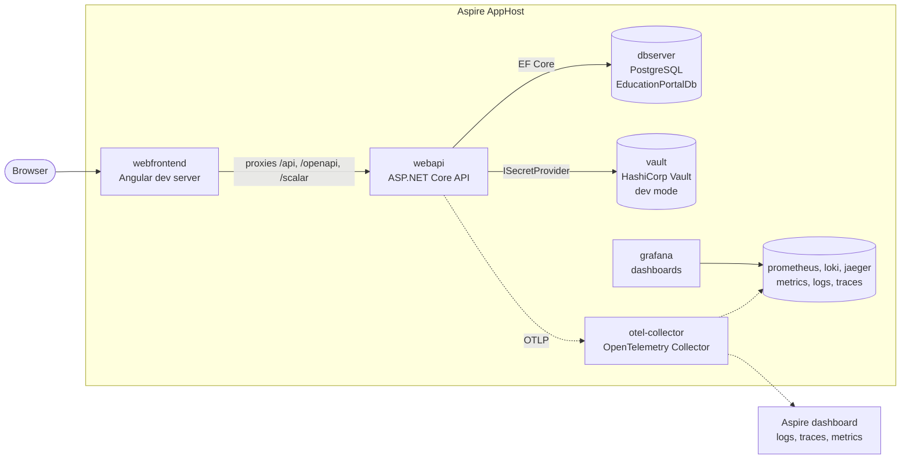

| Resource | Source | What it does |
|---|---|---|
| `webfrontend` | `src/Web/ClientApp` | Runs `npm start` (`ng serve`) on a port Aspire picks. Development only. |
| `webapi` | `src/Web` | The API. Also serves the Scalar API reference at `/scalar` and, in production, the built Angular app. |
| `dbserver` | Container | PostgreSQL with the `EducationPortalDb` database. The container is persistent: it keeps running after you stop the app, until you stop it in Docker Desktop. |
| `vault` | Container | HashiCorp Vault in dev mode on `http://localhost:8200`, the local secret store ([secrets](#secrets)). Persistent like `dbserver`, but its data lives in memory. Development only. |
| `otel-collector` | Container | OpenTelemetry Collector on `localhost:4317` (gRPC) and `4318` (HTTP). The API's only telemetry endpoint; forwards to Prometheus, Loki, Jaeger and the Aspire dashboard ([observability](#observability)). Development only. |
| `prometheus`, `loki`, `jaeger` | Containers | Metrics on `http://localhost:9090`, logs on `http://localhost:3100`, traces on `http://localhost:16686`. Persistent, with named volumes and 7 days of data. Development only. |
| `grafana` | Container | Dashboards on `http://localhost:3000` (anonymous admin, local only), with the three data sources and the **Education Portal overview** dashboard provisioned. Development only. |

Every local container is declared in the AppHost as an Aspire resource. The project has no docker-compose files (AGENTS.md section 6).

In production there is no separate Angular server. `dotnet publish` builds the Angular app into the API's `wwwroot`, so one container serves both the pages and the API. The AppHost is already set up to publish to Azure Container Apps with Azure Database for PostgreSQL, but hosting and CI/CD are still open decisions (AGENTS.md, section 9).

### Clean Architecture layers

Dependencies point inwards. `Web` and `Infrastructure` depend on `Application`, which depends on `Domain`. `Domain` and `Application` never reference `Infrastructure` or `Web`: `Application` declares interfaces, such as `IApplicationDbContext` and `IUser`, and the outer layers implement them.

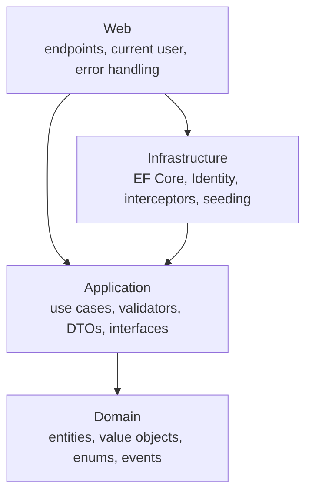

| Project | Contains | References |
|---|---|---|
| `Domain` | Entities, value objects, enums, domain events, constants | nothing |
| `Application` | Use cases as MediatR commands and queries, FluentValidation validators, DTOs and AutoMapper maps, pipeline behaviours, interfaces | `Domain` |
| `Infrastructure` | `ApplicationDbContext` (EF Core + Identity), entity configurations, save interceptors, `IdentityService`, database initialiser and seed data, the secrets layer, OpenTelemetry setup (`AddObservability`) | `Application`, `Shared` |
| `Web` | The ASP.NET Core host: endpoint groups in `Endpoints/`, `CurrentUser`, `ProblemDetailsExceptionHandler`, OpenAPI and Scalar, the Angular app | `Application`, `Infrastructure`, `ServiceDefaults` |
| `ServiceDefaults` | Health checks, HTTP resilience, service discovery | nothing |
| `Shared` | Aspire resource names used by the AppHost, `Infrastructure` and the tests | nothing |
| `AppHost` | Aspire orchestration (the startup project) | `Web`, `Shared` |

Use cases query the database through `IApplicationDbContext` with EF Core directly. There is no repository layer ([ADR-001](Education%20Portal%20Full%20Stack%20App/docs/decisions/ADR-001-Use-EFCore-In-Application-Layer.md)).

### How a request flows

Every API call takes the same path. Endpoints stay thin: they turn the HTTP request into a MediatR command or query and send it.

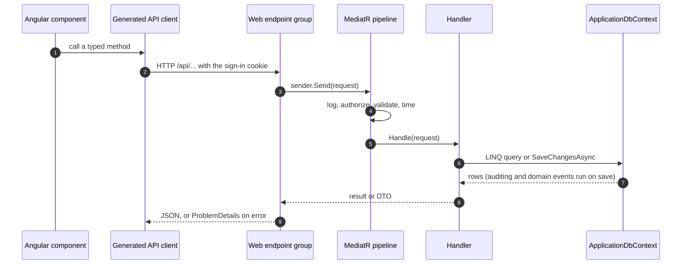

The MediatR pipeline (`src/Application/DependencyInjection.cs`) runs in this order:

| # | Step | What it does |
|---|---|---|
| 1 | `LoggingBehaviour` | Logs the request name and the user. It also logs the whole request today, which is a known gap to fix (SEC-LOG-02). |
| 2 | `UnhandledExceptionBehaviour` | Logs any unhandled exception, then rethrows it. |
| 3 | `AuthorizationBehaviour` | Enforces `[Authorize]`, roles and policies declared on the request class. |
| 4 | `ValidationBehaviour` | Runs the request's FluentValidation validators. |
| 5 | `PerformanceBehaviour` | Logs a warning when a request takes longer than 500 ms. |

Step 2 adds a permission check after authorization: the module is switched on for the school, the user's role allows the action, and the user is assigned to the branch.

`ProblemDetailsExceptionHandler` turns exceptions into standard error responses:

| Exception | HTTP status |
|---|---|
| `ValidationException` (from validators) | 400, with the errors per field |
| `UnauthorizedAccessException` | 401 |
| `ForbiddenAccessException` | 403 |
| `NotFoundException` (from `Guard.Against.NotFound`) | 404 |
| Anything else | 500 |

### Frontend and the generated API client

- The Angular app lives in `src/Web/ClientApp`. In development, `npm start` runs `ng serve`, and `proxy.conf.js` forwards `/api`, `/openapi` and `/scalar` to the API, so the browser sees one site and the sign-in cookie just works.
- The TypeScript client `src/app/web-api-client.ts` is **generated, never edited by hand, and not committed**:
  1. Building `src/Web` writes the OpenAPI document to `src/Web/openapi/v1.json`.
  2. `npm start` and `npm run build` first run `npm run generate-api`, where NSwag (`nswag.json`) turns that document into one Angular service per endpoint group, such as `UsersClient`.
- The app is standalone and zoneless (`bootstrapApplication` in `src/main.ts`, signals for state). Its layout (sidebar, top bar, display settings) and styles come from the maintainer's theme in [`Theme Angular/`](Theme%20Angular/), which every new screen uses as its guide ([ENG-UI-17](docs/ai/engineering/angular-material-ui/SKILL.md)). Folders: `core/` (auth, HTTP interceptors, branding, layout, i18n), `shared/` (theme components), `features/` (login, home, branding, schools, countries).
- Before the first screen renders, `BrandingService` loads `GET /api/Branding` for the current address and applies the school's accent colour, sidebar colour, logo, favicon and name. The sidebar text colour is picked for at least 4.5:1 contrast with any colour a school chooses.
- `AuthService` signs in with `POST /api/Users/login`, then asks `GET /api/Users/me` for the signed-in user. That answer also carries a fresh antiforgery token. `sessionInterceptor` sends the session cookie with every request and redirects to `/login` when the API answers 401, except for the answers from `/api/Users/me` and `/api/Users/login`. `antiforgeryInterceptor` copies the `__Host-XSRF-TOKEN` cookie into the `X-XSRF-TOKEN` header of every unsafe request.
- **Languages.** Before the app's code is imported, `src/main.ts` asks `GET /api/Localization` which language to use, loads its translations (`src/locale/messages.<language>.json`, served at `/i18n/`) with `@angular/localize`'s `loadTranslations`, and sets `<html lang dir>`, so Arabic and Urdu are laid out right to left. Templates use `i18n` attributes and code uses `$localize`, each with a custom id; `npx ng extract-i18n` refreshes `src/locale/messages.json`, and `translations.spec.ts` fails when a translation is missing. The language dropdown (top bar and sign-in page) saves the choice with `PUT /api/Localization/language` and reloads. Dates and times on screen use the `localDate` pipe (`app/core/i18n/local-date.pipe.ts`), which formats the API's UTC instants in the page's culture and the user's time zone; Angular's `date` pipe only takes fixed offsets, so it is not used for that. Module names and descriptions, stored in English on the server, are translated by key with the `moduleText` pipe. Why runtime loading and not one build per language: [ADR-005](Education%20Portal%20Full%20Stack%20App/docs/decisions/ADR-005-Localization-Per-Country.md).
- In production the API serves the built Angular files and falls back to `index.html` for app routes.

### Sign-in and accounts

- ASP.NET Core Identity from the template (kept on purpose), with users and roles in the same PostgreSQL database.
- Three endpoints under `/api/Users` (`login`, `logout` and `me`) replace the template's Identity API endpoints. Signing in sets a session cookie.
- `CurrentUser` (in `Web`) gives the Application layer the signed-in user's id and roles through `IUser`.
- There is no public sign-up: staff create accounts. The template's register endpoint and page are removed.
- The security rules ask for more than the template defaults: a stronger password policy, account lockout, secure host-only cookies, session timeouts, and MFA for master users, school owners and staff who can change data ([authentication skill](docs/ai/secure-compliance/authentication/SKILL.md)). Step 2a adds the stronger password policy, lockout, secure host-only cookies, session timeouts and sign-in rate limits. The decisions are in [ADR-004](Education%20Portal%20Full%20Stack%20App/docs/decisions/ADR-004-Security-Baseline.md). MFA is not built yet.

### Multi-tenancy and permissions (step 2, in progress)

Built so far: schools with their own domains, exactly one master tenant, tenant resolution from the host, sign-in scoped to the school, per-school branding, and module switches per school. Branches and roles come next.

The rules live in [AGENTS.md, section 2](AGENTS.md#2-multi-tenancy-and-permissions). This is how they fit together.

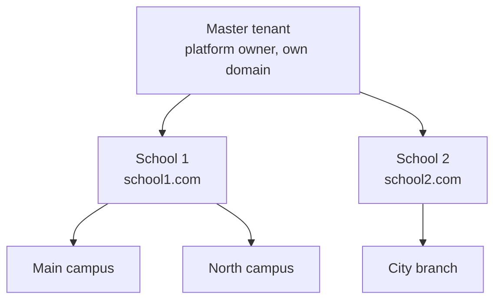

- **One shared database.** Rows owned by a school have a `SchoolId`, and branch data also has a `BranchId`. EF Core global query filters add those conditions to every query, so handlers never filter by tenant by hand. Only explicitly authorized and audited master-tenant use cases read across schools.
- **The domain picks the school.** Each school has its own domain. Before any endpoint runs, the API looks up the request's host in a domain table, and an unknown domain gets 404 with nothing served. The master portal has its own domain. The school is never taken from the request body, query string or a header. For local development, `localhost` is the master tenant and `demo.localhost` is the Demo School.
- **The user must belong to that school.** The school in the user's sign-in must match the domain's school on every request; a mismatch is rejected and audited. Sign-in cookies are host-only, so a session from `school1.com` is never sent to `school2.com`.
- **The branch is picked inside the app.** Branches never get their own domain. Staff, students and parents can belong to several branches and switch between them in the app, with the branch in the route (for example `/branches/12/students`). The server checks that branch against the user on every request.
- **Languages come from the school's country.** The master tenant manages countries (languages offered, default language, time zone, currency) on the **Countries and languages** page and assigns each school to one on the **Schools** page. ASP.NET Core request localization, with a culture provider that knows the school, answers each request in one of that school's languages only: the visitor's choice, then the browser's, then the country's default. Server messages come from `.resx` files: error titles in `src/Web/Resources`, validation messages and the property names inside them in `src/Application/Common/Localization` (Arabic and Urdu next to English; FluentValidation's built-in messages ship in Arabic, and the portal adds Urdu) ([ADR-005](Education%20Portal%20Full%20Stack%20App/docs/decisions/ADR-005-Localization-Per-Country.md)).
- **Permissions are checked on the server.** Effective access = modules the master switched on for the school ∩ the rights the user's role gives per module (View, Create, Edit, Delete) ∩ the user's branches. The check runs in the MediatR pipeline, so hiding a button in Angular is never the only protection.

Every request to a school's domain passes these checks:

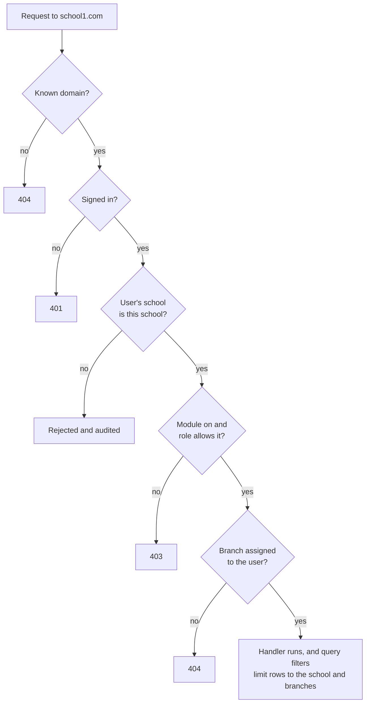

A record from another school or branch returns 404 rather than 403, so ids can't be used to probe other tenants.

**Ids on the API** (decided 2026-11-11, [ADR-008](Education%20Portal%20Full%20Stack%20App/docs/decisions/ADR-008-Guid-Public-Ids-And-Numeric-Enums.md), [identifiers-enums skill](docs/ai/engineering/identifiers-enums/SKILL.md)). Every entity has an internal `int Id` (PostgreSQL `integer`) for keys, joins and query filters, and a `Guid PublicId` (version 7, an alternate key). The API only ever shows the `Guid`: routes are `{id:guid}`, DTOs carry `Guid` ids, and an internal number in a route or query string is refused. Handlers turn the `Guid` into the `int` before any business logic (`ResolveIdAsync`), through the tenant query filters, so another school's id is simply not found. Enums travel by name (`"Logo"`, never `2`), are stored as their number, and each enum column has a seeded lookup table (for example `ModuleTypes`, `SecurityAuditEventTypes`) so SQL reports can read the names.

- **School requests** (decided 2026-11-10). The login page links to a public "Request a school" form (`POST /api/SchoolRequests`, rate-limited per address). It creates a pending request only. The master tenant approves it; nothing else is created. Soft-deleted and inactive schools are hidden or refused (see below).
- **Soft delete and active switch.** Schools and countries inherit `BaseSoftDeletableEntity`: deleted rows are hidden everywhere by a global query filter, and an inactive school's host is refused at tenant resolution. The master tenant cannot be switched off.
- **Exactly one master tenant.** A unique index on the `Schools` table allows only one row with `IsMaster`, and the master is created only by seeding. Every other school is a school-owner tenant.
- **Branding per school.** Each school has an accent colour (a colour picker, stored as #rrggbb, default cyan), an optional sidebar colour, a logo and a favicon. `GET /api/Branding` and `GET /api/Branding/images/{Logo|Favicon}` are public, because the login page needs them before sign-in, and only ever return the school of the request's address. A school's administrator changes its own branding with `PUT /api/Branding` (Settings, Branding); the master tenant's administrator lists schools with `GET /api/Schools` (the Schools page searches them by name with `search`, ignoring case, and limits them to one country with `countryId`; both filter on the server, so paging stays right) changes any school's branding with `GET`/`PUT /api/Schools/{id}/branding`, and views any school's logo and favicon with `GET /api/Schools/{id}/branding/images/{Logo|Favicon}`. Uploads are checked by their bytes: logo PNG, JPEG or WebP up to 512 KB, favicon PNG or ICO up to 100 KB, never SVG. They are stored in the database and served as attachments with `nosniff`. Every change is audited.

- **Modules per school** (decided 2026-11-11). Every module is one of two types: **default** (on for every school automatically, new schools included) or **custom** (off until the master switches it on for a school). The type is the `ModuleType` enum (`Default`, `Custom`). On the Modules page the master sets each module's type and its **Active** switch (`GET /api/Modules`, `PUT /api/Modules/{key}` with `{ type, isActive }`); an inactive module is off for every school. The master switches any module on or off for one school under Schools, Modules (`GET /api/Schools/{id}/modules`, `PUT /api/Schools/{id}/modules/{key}`). A choice for a school wins over the default from then on. Every change is audited. Signed-in users get their school's modules from `GET /api/Modules/enabled`, and the menu hides the rest; the server refuses a request to a module that is off with 403 (`[Authorize(Module = ...)]`). AGENTS.md has the full table and the starting default/custom split. Schools, the module switches and the cross-school overview are for the master tenant only.

### Data and database

- `ApplicationDbContext` (in `Infrastructure`) is the EF Core context for both Identity and the app's own tables. Entity mappings are `IEntityTypeConfiguration<T>` classes in `src/Infrastructure/Data/Configurations/`, picked up automatically.
- Keys are `int` internally and every entity also has a unique `Guid PublicId`, the only id the API exposes (ENG-ID-01..03). Enum columns are integers with a foreign key to a lookup table seeded from the enum (`Infrastructure/Data/Lookups`, ENG-ENUM-03/04).
- `AuditableEntityInterceptor` fills `Created`, `CreatedBy`, `LastModified` and `LastModifiedBy` on entities that inherit `BaseAuditableEntity`.
- Entities raise domain events instead of calling services. `DispatchDomainEventsInterceptor` publishes them through MediatR just before the changes are saved.
- Aspire passes the connection string (`ConnectionStrings__EducationPortalDb`) to the API, so there is nothing to configure locally.
- In Development the database is dropped and recreated on every start (`ApplicationDbContextInitialiser`: `EnsureDeleted`, then `EnsureCreated`) and then seeded. There are no EF Core migrations yet. They are required before any shared environment exists.
- Student data is treated with the most care: personal fields are labelled by data class, never logged, and only ever synthetic in development and tests ([student-data-privacy skill](docs/ai/secure-compliance/student-data-privacy/SKILL.md)).

### Secrets

Secrets go through one cloud-agnostic layer ([ADR-006](Education%20Portal%20Full%20Stack%20App/docs/decisions/ADR-006-Cloud-Agnostic-Secrets.md)). Code uses logical keys only: `platform/{name}` through `ISecretProvider`, and the current school's `tenants/{schoolId}/{name}` through `ITenantSecretProvider`, which takes the school from the request's host. Values are cached in memory for 10 minutes, transient failures are retried, and values are never stored in the database, logged or put in exception messages. A `secrets` health check is added when a store is configured.

**Local Vault.** `aspire run` starts the `vault` container, generates its root token (kept in the AppHost's user-secrets as `Parameters:vault-dev-token`) and gives the API `Secrets__Provider=HashiCorp`, the address and the token. Dev mode keeps data in memory, so seed it after the container starts for the first time or is recreated. From `Education Portal Full Stack App`, with the app running:

```bash
./scripts/vault-seed.sh      # macOS, Linux, Git Bash
./scripts/vault-seed.ps1     # Windows PowerShell
```

The scripts read the token from the AppHost's user-secrets (or `VAULT_TOKEN`) and write placeholder values to `platform/sample-api-key`, `tenants/1/sms-api-key` and `tenants/2/sms-api-key`. To browse Vault, open `http://localhost:8200` and sign in with that token. `platform/db-connection` is not seeded locally because Aspire already provides the database; when the store has it, it wins over other configuration.

**Switching store.** Set these settings (as environment variables, for example `Secrets__Provider`) on the deployed app. Nothing else changes:

| `Secrets:Provider` | Also set | Identity |
|---|---|---|
| `HashiCorp` | `Secrets:HashiCorp:Address`, `MountPoint` (default `secret`, KV v2), `AuthMethod` = `Token` (`Secrets__HashiCorp__Token`) or `AppRole` (`Secrets__HashiCorp__RoleId`, `Secrets__HashiCorp__SecretId`) | Token or AppRole, from environment variables or user-secrets only |
| `AzureKeyVault` | `Secrets:AzureKeyVault:VaultUri` | `DefaultAzureCredential` (managed identity) |
| `Aws` | `Secrets:Aws:Region` | Default credential chain (IAM role) |
| `Gcp` | `Secrets:Gcp:ProjectId` | Application default credentials |

`Secrets:CacheTtlMinutes` (1 to 1440, default 10) sets the cache time. With `Secrets:Provider` empty the app runs on normal configuration and any secret use fails with a clear message. Missing settings for the chosen store stop startup with a message naming the missing key.

### Observability

The API sends OpenTelemetry logs, metrics and traces over OTLP to one endpoint, `Observability:OtlpEndpoint` ([ADR-007](Education%20Portal%20Full%20Stack%20App/docs/decisions/ADR-007-OpenTelemetry-Observability.md)), so the backend can change by configuration alone. Locally that is the `otel-collector` container, which forwards metrics to Prometheus, logs to Loki, traces to Jaeger and a copy of everything to the Aspire dashboard. Grafana (`http://localhost:3000`) links a trace to its logs and back by trace id, and its **Education Portal overview** dashboard shows request rate, error rate, p95 latency, the slowest endpoints and the vault cache hit ratio. Every request span and log line carries `tenant.id` (the SchoolId); EF Core and PostgreSQL calls show up in the traces. How to start it, the walkthrough, what must never be recorded and how to add a span or metric are in [docs/observability.md](Education%20Portal%20Full%20Stack%20App/docs/observability.md). `ServiceDefaults` adds resilience and service discovery to `HttpClient` and maps the health endpoints `/health` and `/alive` (Development only). Security-relevant actions, such as sign-ins, role and module changes and cross-tenant attempts, will also write audit events.

### Tests

| Project | What it covers | Needs |
|---|---|---|
| `tests/Domain.UnitTests` | Entities and value objects | nothing |
| `tests/Application.UnitTests` | Pipeline behaviours, exceptions, AutoMapper configuration | nothing |
| `tests/Infrastructure.IntegrationTests` | Empty for now; meant for EF Core and Identity tests | nothing |
| `tests/Application.FunctionalTests` | Use cases end to end through MediatR, against a real PostgreSQL started by `tests/TestAppHost`. Respawn clears the data between tests. | Docker |
| `tests/Web.AcceptanceTests` | Browser tests written as Reqnroll `.feature` files and run by Playwright against the whole app started by the AppHost | Docker and the Playwright browsers |
| `src/Web/ClientApp` | Angular unit tests with Vitest | Node.js |

Every new use case gets functional tests proving that an unauthenticated call gets 401, another school 404, another branch 404, a switched-off module 403 and a missing role right 403.

## Technology flows

One diagram per technology or major flow, drawn from the code. The runtime picture, the layers, the MediatR request path and the tenant checks are in the [architecture overview](#architecture-overview); this section adds the rest. Each diagram names the file that implements it.

### Aspire orchestration flow

`src/AppHost/Program.cs` and `src/AppHost/ObservabilityStack.cs`. In run mode (F5 or `aspire run`) the AppHost starts the containers first and the API only once its dependencies are healthy. In publish mode only the API and the database are described, for Azure Container Apps.

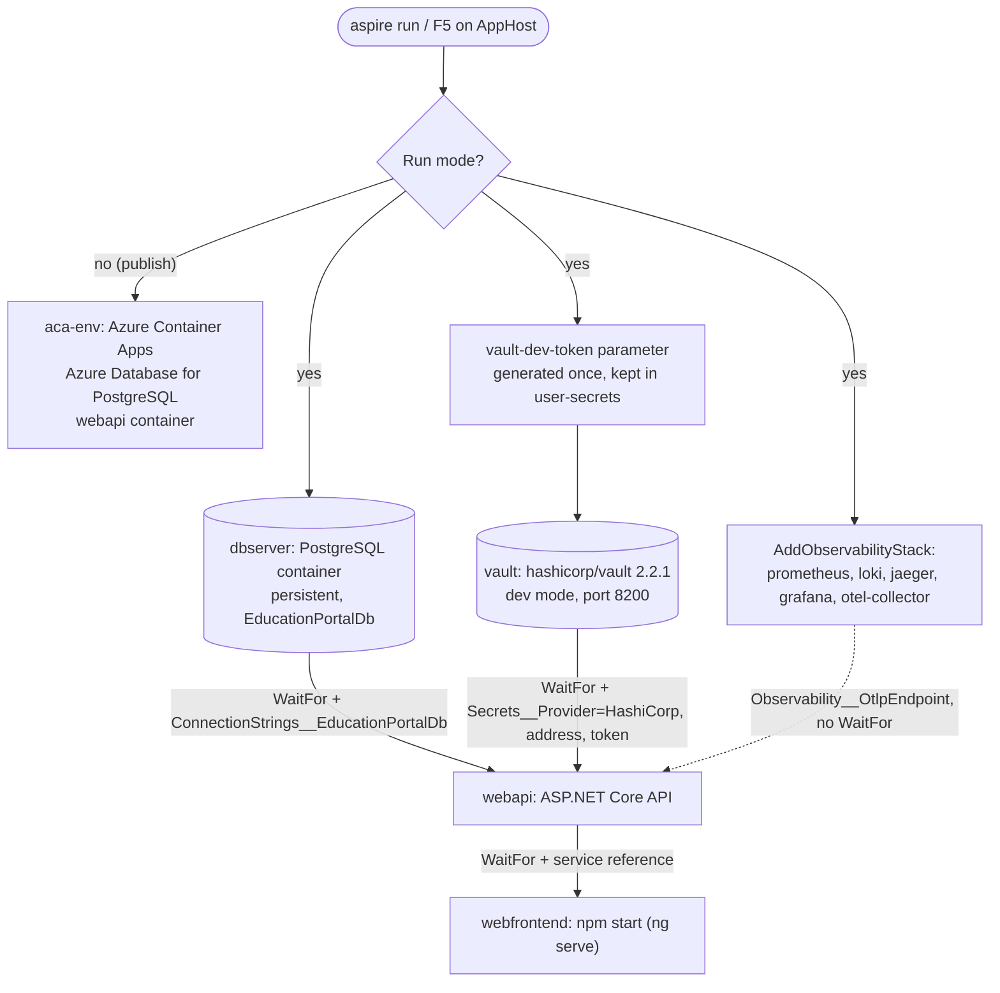

The API does not wait for the Collector on purpose: the app must run when telemetry is down, and export retries in the background.

### ASP.NET Core middleware pipeline

`src/Web/Program.cs`. Every request passes these steps in this order before an endpoint runs.

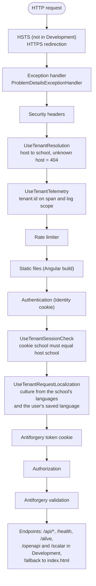

### Tenant resolution flow

`src/Web/Infrastructure/TenantResolution.cs` and `src/Infrastructure/Identity/TenantResolver.cs`. The school always comes from the host, never from the body, query string or a header.

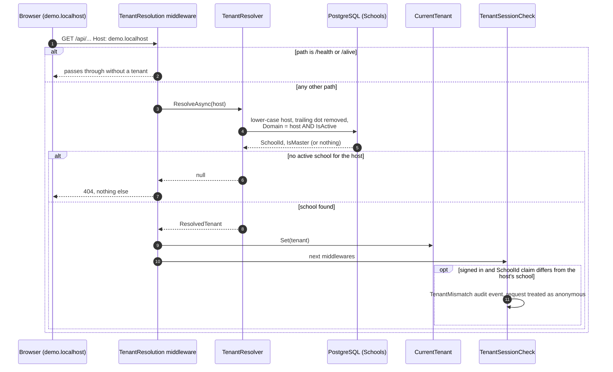

### Sign-in flow (ASP.NET Core Identity)

`src/Web/Endpoints/Users.cs`, the `SignIn` use case in `src/Application/Users`, `src/Infrastructure/Identity/IdentityService.cs` and `ApplicationUserClaimsPrincipalFactory.cs`.

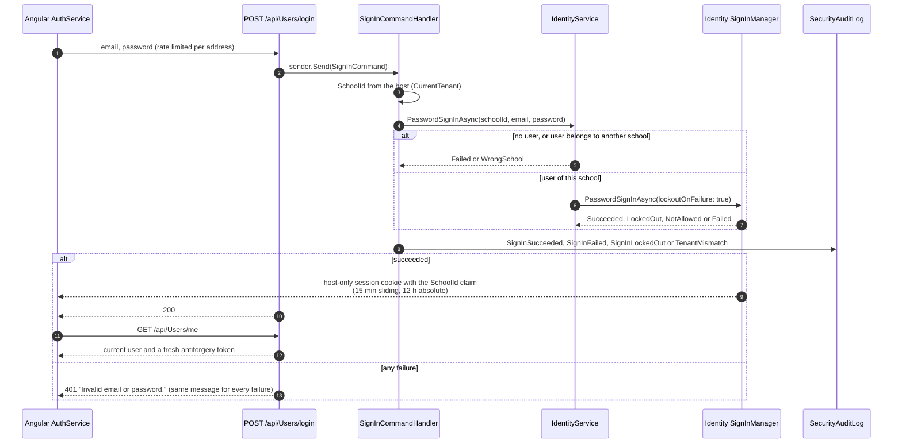

### Authorization and module check flow

`src/Application/Common/Behaviours/AuthorizationBehaviour.cs` and `src/Application/Modules/Common/ModuleAccess.cs`. This is step 3 of the [MediatR pipeline](#how-a-request-flows), driven by the `[Authorize]` attribute on each request.

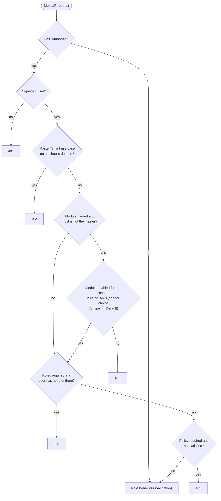

Role rights per module (View, Create, Edit, Delete) and branch checks are added here as step 2 continues.

### EF Core and PostgreSQL flow

`src/Infrastructure/Data/ApplicationDbContext.cs`, `Data/Interceptors/` and `ApplicationDbContextInitialiser.cs`.

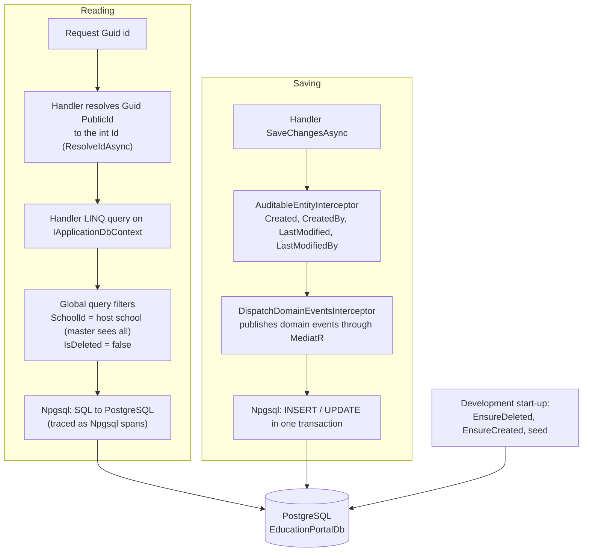

The tenant filters cover `BrandingImage` and `SchoolModule` today. Every new school-owned entity is added to them (AGENTS.md section 2).

### Secrets flow

`src/Infrastructure/Secrets/` ([ADR-006](Education%20Portal%20Full%20Stack%20App/docs/decisions/ADR-006-Cloud-Agnostic-Secrets.md)). Platform secrets such as the database connection are read once at start-up; everything else goes through a decorated provider at run time.

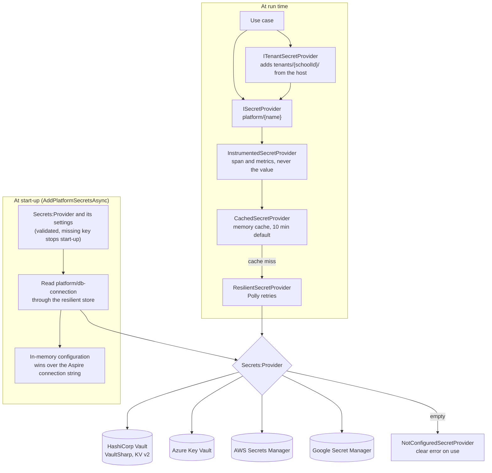

### Observability flow (OpenTelemetry)

`src/Infrastructure/Observability/`, `src/AppHost/ObservabilityStack.cs` and `src/AppHost/observability/` ([ADR-007](Education%20Portal%20Full%20Stack%20App/docs/decisions/ADR-007-OpenTelemetry-Observability.md)).

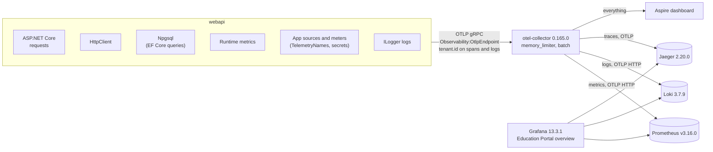

Traces are sampled at 100% in Development and 10% elsewhere. Jaeger stays on 2.20.0 because later versions removed the API that Grafana's Jaeger data source uses.

### Localization flow

`src/Web/Infrastructure/TenantRequestLocalization.cs` ([ADR-005](Education%20Portal%20Full%20Stack%20App/docs/decisions/ADR-005-Localization-Per-Country.md)).

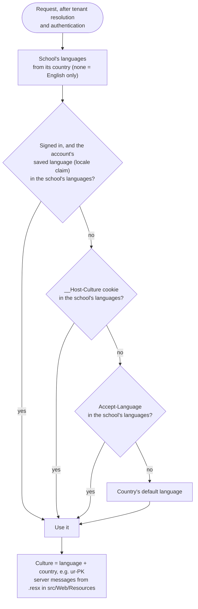

- **The language follows the user.** Changing the language while signed in also saves it on the account (`AspNetUsers.PreferredLanguage`), so it applies on every device after sign-in; the sign-in page reloads into it when it differs. Before sign-in, the browser's cookie and languages decide.
- **Time zones.** Dates are stored and sent as UTC. The Angular app sends the device's IANA time zone in an `X-Time-Zone` header with every request to its own server (`timeZoneInterceptor`, and `main.ts` for the first call). `IRequestTimeZone` gives handlers that zone, else the school's country zone, else UTC, for anything the server turns into text or a calendar day. `GET /api/Localization` returns it as `userTimeZone`, and screens show dates in it.

### Angular start-up flow

`src/Web/ClientApp/src/main.ts`, `app/app.config.ts` and `app/core/`.

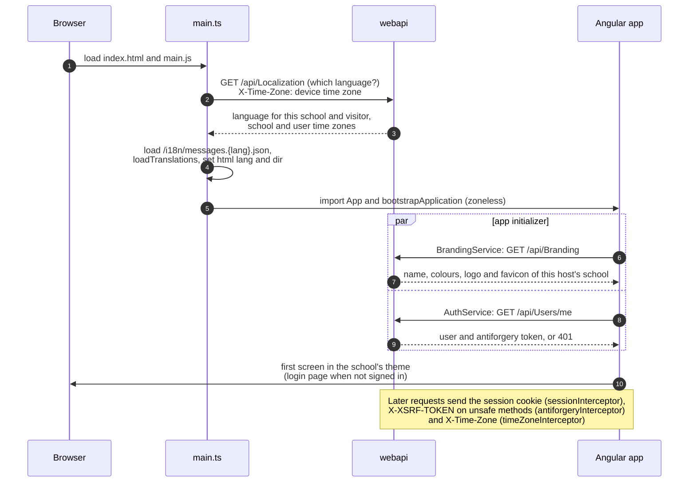

### NSwag API client generation flow

`src/Web/ClientApp/nswag.json` and `package.json`. The client is generated, never edited by hand and not committed.

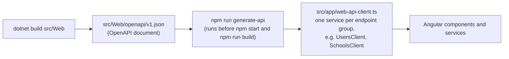

### Test flow

`tests/` and `src/Web/ClientApp`. `dotnet test` runs every .NET project; Docker must be running for the functional and acceptance tests.

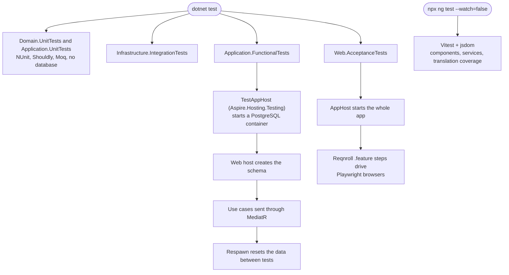

### Compliance guards flow

`.githooks/pre-commit`, `.github/workflows/compliance-guards.yml` and `.github/workflows/compliance-sources-review.yml`.

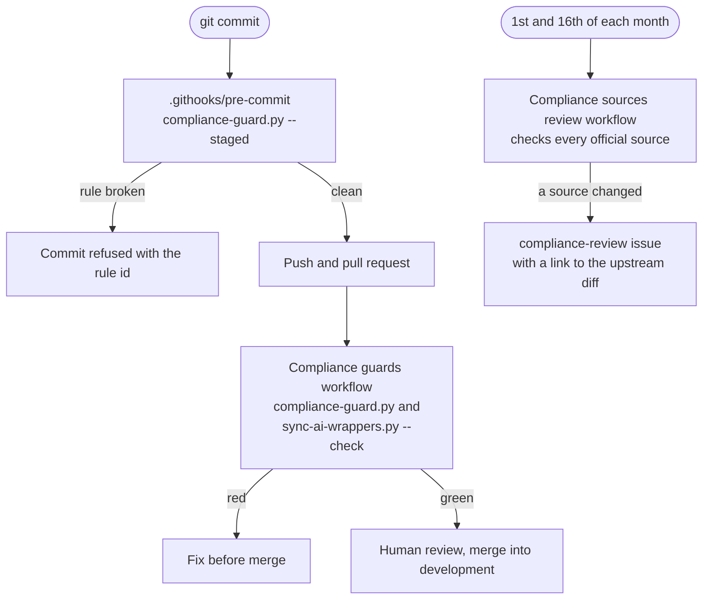

## Development process

### Security and compliance rules

Every change, by a person or an AI assistant, follows [docs/ai/secure-compliance/SKILL.md](docs/ai/secure-compliance/SKILL.md), an overview that links to one skill per topic and one per standard (FedRAMP, GovRAMP, SOC 2, ISO 27001, OWASP, EU, PCI DSS). Together they hold numbered rules (such as `SEC-AUTHZ-03`) mapped to FedRAMP Moderate Rev 5 / NIST SP 800-53, GovRAMP, SOC 2, ISO/IEC 27001:2022 and the OWASP Top 10, plus EU rules (GDPR and related law) and PCI DSS v4.0.1 rules for card payments (when fees are added). CI guards on every pull request enforce the rules that can be checked automatically. If a request would break a rule, stop and name the rule. The ones that shape everyday work:

- Every endpoint needs a signed-in user, and every MediatR request declares the module and right it needs (deny by default).
- The school comes only from the domain. A branch id from the route is always checked against the user.
- Records from another school or branch return 404; a switched-off module or missing right returns 403.
- No secrets and no real personal data in code, tests, logs, commits or pull requests. Test and demo data is synthetic.
- Never log personal data such as names, emails or grades; log ids instead.
- Every pull request fills in the security checklist from the pull request template.

The rules help the product support those frameworks' controls; they do not make it certified or authorized, so never describe it as compliant. Section 8 of the overview lists where the template code doesn't meet them yet (and `docs/ai/compliance-guard-baseline.json` allows only those); those gaps are being fixed in dedicated pull requests.

<!-- BEGIN GENERATED: compliance skills (docs/ai/sync-ai-wrappers.py) -->
#### Compliance skills and update checks

All compliance skills in the repository (generated from `docs/ai/secure-compliance/` and its `sources.json` by `docs/ai/sync-ai-wrappers.py`, so this list is always current). Every source is checked for updates on the 1st and 16th of each month by `.github/workflows/compliance-sources-review.yml`, which opens a `compliance-review` issue.

| Skill | Kind | Sources and versions tracked |
|---|---|---|
| [secure-compliance](docs/ai/secure-compliance/SKILL.md) | Overview | (rules only; see the standard skills) |
| [authentication](docs/ai/secure-compliance/authentication/SKILL.md) | Topic | SP 800-63-4 (Rev 4) |
| [authorization-tenant-isolation](docs/ai/secure-compliance/authorization-tenant-isolation/SKILL.md) | Topic | (rules only; see the standard skills) |
| [change-management](docs/ai/secure-compliance/change-management/SKILL.md) | Topic | (rules only; see the standard skills) |
| [configuration-environments](docs/ai/secure-compliance/configuration-environments/SKILL.md) | Topic | (rules only; see the standard skills) |
| [cryptography-secrets](docs/ai/secure-compliance/cryptography-secrets/SKILL.md) | Topic | (rules only; see the standard skills) |
| [dependencies-supply-chain](docs/ai/secure-compliance/dependencies-supply-chain/SKILL.md) | Topic | (rules only; see the standard skills) |
| [error-handling](docs/ai/secure-compliance/error-handling/SKILL.md) | Topic | (rules only; see the standard skills) |
| [input-validation](docs/ai/secure-compliance/input-validation/SKILL.md) | Topic | (rules only; see the standard skills) |
| [logging-audit](docs/ai/secure-compliance/logging-audit/SKILL.md) | Topic | OMB M-21-31 (2021) |
| [security-testing](docs/ai/secure-compliance/security-testing/SKILL.md) | Topic | (rules only; see the standard skills) |
| [standard-eu](docs/ai/secure-compliance/standard-eu/SKILL.md) | Standard | Regulation (EU) 2016/679 and current EDPB guidelines; Regulation (EU) 2024/1689; Directive (EU) 2022/2555; Regulation (EU) 2024/2847 |
| [standard-fedramp-moderate](docs/ai/secure-compliance/standard-fedramp-moderate/SKILL.md) | Standard | SP 800-53 Rev 5 (latest release in the OSCAL catalog); FedRAMP Rev 5 Moderate baseline; SP 800-63-4 (Rev 4); OMB M-21-31 (2021) |
| [standard-govramp](docs/ai/secure-compliance/standard-govramp/SKILL.md) | Standard | SP 800-53 Rev 5 (latest release in the OSCAL catalog); GovRAMP program and security baselines (NIST SP 800-53 Rev 5 based) |
| [standard-iso27001](docs/ai/secure-compliance/standard-iso27001/SKILL.md) | Standard | ISO/IEC 27001:2022 (with Amd 1:2024) |
| [standard-owasp-top10](docs/ai/secure-compliance/standard-owasp-top10/SKILL.md) | Standard | OWASP Top 10:2025 |
| [standard-pci-dss](docs/ai/secure-compliance/standard-pci-dss/SKILL.md) | Standard | PCI DSS v4.0.1 (June 2024); SAQ A v4.0.1 (January 2025 revision) |
| [standard-soc2](docs/ai/secure-compliance/standard-soc2/SKILL.md) | Standard | 2017 Trust Services Criteria with revised points of focus (2022) |
| [student-data-privacy](docs/ai/secure-compliance/student-data-privacy/SKILL.md) | Topic | Regulation (EU) 2016/679 and current EDPB guidelines |
| [web-api-hardening](docs/ai/secure-compliance/web-api-hardening/SKILL.md) | Topic | (rules only; see the standard skills) |
<!-- END GENERATED: compliance skills -->

### Engineering rules

Every change also follows [docs/ai/engineering/SKILL.md](docs/ai/engineering/SKILL.md), an overview that links to one skill per topic, with numbered rules such as `ENG-EF-03`. Security and compliance rules win when the two disagree.

- **Design:** SOLID, KISS, DRY and YAGNI as strict rules, applied the way the ADRs already do (for example, handlers use `IApplicationDbContext` directly, no repository layer).
- **Code and process:** readable over clever, tests that describe behaviour, fail fast and loud, surgical changes, small PRs, a shared definition of done, bug fixes separate from refactoring, and dependencies treated as code you don't control.
- **Backend:** C# entities follow Microsoft's domain model guidance (private setters, guard clauses, value objects, domain events, `TimeProvider`), keys are `int` inside and `Guid` on the API, enums go over the API by name and into the database as explicit numbers with lookup tables, and EF Core follows Microsoft's performance and modelling docs (projections, no N+1, paging, async with cancellation, Fluent API, tenant query filters, migrations).
- **Frontend:** Angular follows the Angular team's best practices (standalone, signals, native control flow, Signal Forms) and Google's Material Design 3 through Angular Material, with WCAG 2.2 AA accessibility.
- **AI agents and swarms (including Ruflo):** human approval for high-stakes or irreversible actions, only the context a task needs, a failing test first as the target, small single-purpose tools, and strict validation, retries and fallbacks around anything an agent produces.

The PR template has an engineering checklist next to the security one, and the CI guard also blocks empty `catch` blocks, blocking on async code, `DateTime.Now`, enum members without an explicit number, enums stored as strings and `{id:int}` routes, new `NgModule`s and the old `*ngIf`/`*ngFor` syntax. Every skill names the official guidance it follows (Angular team, Angular Material, Material Design 3, Microsoft .NET and EF Core docs, the official `angular/skills` and `dotnet/skills` collections, Google engineering practices, OWASP), and the same twice-monthly check that watches the compliance standards opens an issue with a link to the exact upstream diff when one of them changes. Rules are never overwritten automatically; a reviewed PR applies each change.

<!-- BEGIN GENERATED: engineering skills (docs/ai/sync-ai-wrappers.py) -->
#### Engineering skills and update checks

All engineering skills in the repository (generated from `docs/ai/engineering/` and its `sources.json` by `docs/ai/sync-ai-wrappers.py`, so this list is always current). Every source is checked for updates on the 1st and 16th of each month by `.github/workflows/compliance-sources-review.yml`, which opens a `compliance-review` issue.

| Skill | Kind | Sources and versions tracked |
|---|---|---|
| [engineering-standards](docs/ai/engineering/SKILL.md) | Overview | (index; see the topic skills) |
| [ai-agents](docs/ai/engineering/ai-agents/SKILL.md) | Topic | OWASP Top 10 for LLM Applications 2025; AI RMF 1.0 (NIST AI 100-1) and Generative AI Profile (NIST AI 600-1); github/awesome-copilot agent-safety instructions (main) |
| [angular-material-ui](docs/ai/engineering/angular-material-ui/SKILL.md) | Topic | Angular v22 guidelines (adev/src/context); angular/skills, built 2026-11-10 from angular/angular 0dafb36; angular.dev best practices for Angular v22; Angular Material 22 (Material 3 theming with mat.theme and system tokens); Material Design 3; WCAG 2.2 Level AA |
| [code-quality-process](docs/ai/engineering/code-quality-process/SKILL.md) | Topic | C# 14 / .NET 10 coding conventions; dotnet/skills plugins/dotnet-test (main); google/eng-practices (main) |
| [csharp-entities](docs/ai/engineering/csharp-entities/SKILL.md) | Topic | EF Core 10; .NET Microservices: Architecture for Containerized .NET Applications (current edition on Learn); .NET design guidelines (current on Learn); C# 14 / .NET 10 coding conventions |
| [design-principles](docs/ai/engineering/design-principles/SKILL.md) | Topic | .NET design guidelines (current on Learn); Architect Modern Web Applications with ASP.NET Core and Azure (current edition on Learn) |
| [efcore](docs/ai/engineering/efcore/SKILL.md) | Topic | EF Core 10; Npgsql.EntityFrameworkCore.PostgreSQL 10; dotnet/skills plugins/dotnet-data (main) |
| [identifiers-enums](docs/ai/engineering/identifiers-enums/SKILL.md) | Topic | EF Core 10; .NET design guidelines (current on Learn); ASP.NET Core 10; Azure Architecture Center API design guidance (current on Learn) |
<!-- END GENERATED: engineering skills -->

### Roadmap

| Step | Scope | Status |
|---|---|---|
| 1. Baseline | Turn the template into the `EducationPortal` solution: Angular and PostgreSQL only, samples removed, build and tests green | Done (PR #1) |
| 2. Schools, branches and permissions | Schools and their domains, module switches in the master portal, branches, roles and staff, plus tests that schools and branches can't see each other's data | In progress |
| 3. Academics | Students, teachers, parents, courses, enrolments and grades (several scored assessments per enrolment), all respecting modules and branches | Next |
| 4. Master overview and polish | Cross-school dashboard, demo data, smoke tests per role | Planned |

Out of scope for the MVP: fees, attendance, timetables, billing schools, microservices and database-per-school.

### Branches and pull requests

`main` holds released work. `development` is the integration branch, so check it out for the latest code. Nobody pushes to `main` or `development` directly.

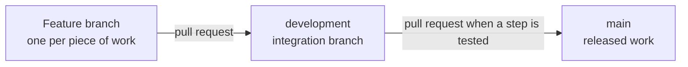

1. Start from the latest `development` and create a short-lived branch, for example `feature/school-domains`.
2. Build the change in layers (see [Adding a feature](#adding-a-feature)). One roadmap step is one reviewable pull request, or a few if the step is big.
3. Run the checks in the [definition of done](#definition-of-done), including updating this README for any change to technologies, flows, features, setup or configuration. The compliance guards also run in CI on every pull request, and the README guard fails a pull request that changes those without touching `README.md` (see `AGENTS.md` section 7, rule 8). The review checklist guard fails a pull request whose description does not answer and tick the six review questions (see `AGENTS.md` section 7, rule 9).
4. Open a pull request into `development`. Someone other than the author reviews and approves it. Changes to sign-in, permissions, tenant resolution, query filters, cryptography, logging and audit, or CI need the maintainer's review.
5. When a roadmap step is complete and tested, open a pull request from `development` into `main`.

Record new or changed decisions in `AGENTS.md` in the same pull request, and write an ADR in `docs/decisions/` for security-relevant design decisions.

### Adding a feature

Work from the inside out. Using a `Courses` feature as the example:

1. **Domain:** add `src/Domain/Entities/Course.cs`, inheriting `BaseAuditableEntity` (which brings the `int Id` and the `Guid PublicId`). Give tenant-owned entities an `int SchoolId`, and also a `BranchId` if they belong to a branch. Label personal data fields with their data class.
2. **Application:** scaffold the use cases from the `src/Application` folder:

   ```cmd
   dotnet new ca-usecase -n CreateCourse -fn Courses -ut command -rt Guid
   dotnet new ca-usecase -n GetCourses -fn Courses -ut query -rt CoursesVm
   ```

   Each creates one file under `Courses/Commands/` or `Courses/Queries/` with the request, its validator and its handler. Validate every input in the validator. Mark the request with `[Authorize]` and, from step 2, the module and right it needs. Requests are explicit DTOs and never carry a `SchoolId`. Ids in requests and DTOs are the `Guid` public id; the handler resolves them to the `int` key.
3. **Infrastructure:** add `DbSet<Course>` to `IApplicationDbContext` and `ApplicationDbContext`, and a `CourseConfiguration` in `Data/Configurations/`. Check that the tenant query filter covers the new entity.
4. **Web:** add an endpoint group. It is found automatically and served under `/api/Courses`:

   ```csharp
   public class Courses : IEndpointGroup
   {
       public static void Map(RouteGroupBuilder groupBuilder)
       {
           groupBuilder.RequireAuthorization();

           groupBuilder.MapGet(GetCourses);
           groupBuilder.MapPost(CreateCourse);
       }

       public static async Task<Ok<CoursesVm>> GetCourses(ISender sender)
       {
           var vm = await sender.Send(new GetCoursesQuery());

           return TypedResults.Ok(vm);
       }

       public static async Task<Created<Guid>> CreateCourse(ISender sender, CreateCourseCommand command)
       {
           var id = await sender.Send(command);

           return TypedResults.Created($"/{nameof(Courses)}/{id}", id);
       }
   }
   ```

5. **Angular:** run `dotnet build`, then restart the app (or run `npm run generate-api`) so `web-api-client.ts` gets a `CoursesClient`. Then add the component and its route.
6. **Tests:** functional tests for each use case with the five denial cases (401, other school 404, other branch 404, switched-off module 403, missing right 403), validator tests with boundary and malicious input, unit tests for domain logic, and an acceptance test for important screens.

### Definition of done

Before you open a pull request:

- [ ] `dotnet build` passes (warnings are errors).
- [ ] `dotnet test` passes, with Docker running.
- [ ] If you changed the Angular app, `npm run build`, `npx ng test --watch=false` and `npm audit --audit-level=high` are clean in `src/Web/ClientApp`.
- [ ] The six review questions in the pull request's Review checklist are answered and ticked (AGENTS.md section 7, rule 9; `python3 docs/ai/review-checklist-guard.py --pr-body-file body.md` runs the same check as CI).
- [ ] The security checklist in the pull request is filled in ([overview, section 5](docs/ai/secure-compliance/SKILL.md#5-pr-security-checklist)).
- [ ] New use cases have the five denial tests, and new school or branch data has `SchoolId`/`BranchId` and query filters.
- [ ] Any new NuGet or npm package is justified in the pull request (why, licence, maintenance). NuGet versions live only in `Directory.Packages.props`.
- [ ] No secrets, real personal data, `artifacts/`, `bin/`, `obj/` or `node_modules/` are committed.
- [ ] `README.md` is updated in the same pull request for any change to technologies, flows and their diagrams, features, setup or configuration, so it stays an accurate overview (`python3 docs/ai/sync-ai-wrappers.py` refreshes the skills tables). `python3 docs/ai/readme-guard.py --base origin/development` runs the same check as CI.
- [ ] `AGENTS.md` is updated if a decision changed, with an ADR for security-relevant design decisions.

### Command cheat sheet

Run these from the `Education Portal Full Stack App` folder unless the row says otherwise. Commands are shown for the Windows Command Prompt.

| Task | Command |
|---|---|
| Build | `dotnet build` |
| Run everything | `dotnet run --project src\AppHost` or `aspire run` |
| All tests | `dotnet test` |
| One test project | `dotnet test tests\Application.FunctionalTests` |
| Tests whose name contains a word | `dotnet test --filter "FullyQualifiedName~Schools"` |
| Check NuGet packages for known vulnerabilities | `dotnet list package --vulnerable --include-transitive` |
| Install the Angular packages | `npm install` in `src\Web\ClientApp` |
| Regenerate the Angular API client | `npm run generate-api` in `src\Web\ClientApp`, after `dotnet build` |
| Build the Angular app | `npm run build` in `src\Web\ClientApp` |
| Angular unit tests | `npx ng test --watch=false` in `src\Web\ClientApp` |
| Check npm packages for known vulnerabilities | `npm audit --audit-level=high` in `src\Web\ClientApp` |
| Install the scaffolding template (once) | `dotnet new install Clean.Architecture.Solution.Template` |
| Scaffold a use case | `dotnet new ca-usecase -n CreateCourse -fn Courses -ut command -rt Guid` in `src\Application` |
| Install the Playwright browsers (once, after a build) | `pwsh artifacts\bin\Web.AcceptanceTests\debug\playwright.ps1 install` |
| Trust the HTTPS development certificate (once) | `dotnet dev-certs https --trust` |

## Configuration and ports

| What | Value |
|---|---|
| Aspire dashboard | `https://educationportal.dev.localhost:17080` (the console prints a sign-in link) |
| API (`webapi`) | `https://localhost:7052` and `http://localhost:5132` |
| API reference and health (in Development) | Scalar at `/scalar`, the OpenAPI document at `/openapi/v1.json`, health at `/health` and `/alive` |
| Angular app (`webfrontend`) | A port chosen by Aspire. Open it from the dashboard. |
| Database connection | Passed in by Aspire as `ConnectionStrings__EducationPortalDb` |
| Development seed accounts | `administrator@localhost` (master tenant, on `localhost`), `administrator@demo.localhost` (Demo School, Pakistan, on `demo.localhost`) and `administrator@uae.localhost` (Demo School UAE, on `uae.localhost`), password `Local-Dev-Only-2026!` (local database, Development only) |
| Allowed hosts | `localhost` and `*.localhost` in Development (`AllowedHosts`); each school's domain is added when it is deployed |
| Observability | `Observability:OtlpEndpoint` (set to the local Collector by Aspire), `TraceSampleRatio` (1.0 in Development, 0.1 elsewhere), `TenantIdAsMetricLabel` (off), `Enabled`. Grafana `http://localhost:3000`, Prometheus `http://localhost:9090`, Jaeger `http://localhost:16686`, Loki `http://localhost:3100`, Collector `localhost:4317`/`4318` ([docs/observability.md](Education%20Portal%20Full%20Stack%20App/docs/observability.md)) |
| Secrets | `Secrets:Provider` selects the store ([secrets](#secrets)). Locally Aspire runs HashiCorp Vault on `http://localhost:8200` and sets it up for you. Store credentials come from environment variables or user-secrets; never put secrets in `appsettings*.json` or any other file in the repository. |

## Troubleshooting

| Problem | Fix |
|---|---|
| `webfrontend` exits with code 3 | Upgrade Node.js to 22.22.3+ or 24.15+, then run `npm install` again. |
| `dbserver` never becomes healthy | Start Docker Desktop and wait until it says it is running. |
| Build fails on a warning | Warnings are errors in this solution; fix the warning. |
| "A compatible .NET SDK was not found" | Install .NET SDK 10.0.403 or newer (see `global.json`), or update Visual Studio. |
| Certificate warning in the browser, or the dashboard won't open | Run `dotnet dev-certs https --trust` once and restart the app. |
| Angular can't find `web-api-client`, or a new endpoint has no client method | Run `dotnet build` (it writes `openapi/v1.json` in `src/Web`), then restart the app or run `npm run generate-api`. |
| Acceptance tests fail with "Executable doesn't exist" | Install the Playwright browsers (see the [command cheat sheet](#command-cheat-sheet)). |
| Data is gone after a restart | Expected in Development: the database is recreated on every start. |
| `npm install` reports vulnerabilities | Run `npm audit --audit-level=high`. High and critical findings must be fixed before merging, or documented as an approved exception. Use `npm audit fix` without `--force`, which could move Angular to another major version. |

## More

- [AGENTS.md](AGENTS.md): product decisions, multi-tenancy rules, conventions and the MVP plan. It is the source of truth when a decision changes.
- [docs/ai/secure-compliance/SKILL.md](docs/ai/secure-compliance/SKILL.md): the mandatory security and compliance rules.
- [Architecture decision records](Education%20Portal%20Full%20Stack%20App/docs/decisions/README.md)
- [Solution README](Education%20Portal%20Full%20Stack%20App/README.md): code style and scaffolding.
- [Clean Architecture template docs](https://cleanarchitecture.jasontaylor.dev) and [Aspire docs](https://aspire.dev)
